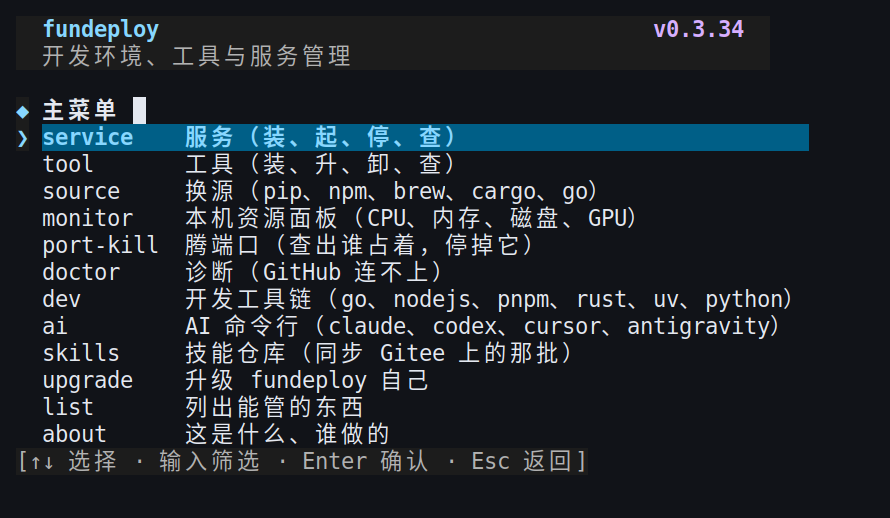

# fundeploy

一条命令管本机的开发环境、常驻服务、工具和镜像源。

单个静态二进制，不依赖 Python、Node 或任何运行时，装上就能跑。支持 macOS 与 Linux 的
x86_64 / arm64。Windows x64 提供本机资源面板。

```bash
curl -fsSL https://raw.githubusercontent.com/farfarfun/fundeploy/HEAD/install.sh | sh
```

## 安装

### 装机脚本

```bash
curl -fsSL https://raw.githubusercontent.com/farfarfun/fundeploy/HEAD/install.sh | sh
```

默认装到 `~/.local/bin/fundeploy`。脚本不会去动你的 shell 配置，该加的 PATH 那行它会打出来。

可选参数与环境变量：

| 变量 | 作用 | 默认 |
| --- | --- | --- |
| `FUNDEPLOY_VERSION` / `--version` | 装哪一版 | `latest` |
| `FUNDEPLOY_BIN_DIR` / `--bin-dir` | 装到哪儿 | `~/.local/bin` |
| `FUNDEPLOY_RELEASE_REPO` | 从哪个仓库的 release 取 | `farfarfun/fundeploy` |
| `FUNDEPLOY_RELEASE_SOURCE` | 从 `github` 还是 `gitee` 取 | 先 GitHub，不通换 Gitee |
| `FUNDEPLOY_GITHUB_HUB_PROXY_PREFIX` | GitHub 直连不通时的加速前缀 | 空 |

### 国内网络

GitHub 连不上时脚本会自动改用 Gitee 上的镜像，不用额外设置。嫌那一次探测（8 秒）
慢就直接点名：

```bash
FUNDEPLOY_RELEASE_SOURCE=gitee \
  curl -fsSL https://gitee.com/farfarfun/fundeploy/raw/master/install.sh | sh
```

连 `raw.githubusercontent.com` 都拿不到脚本本身时，就用上面这个 Gitee 的地址
（Gitee 的 raw 路径要写分支名 `master`，没有 `HEAD` 这种写法）。

镜像由 CI 从 GitHub 整仓同步过去，release 附件一并搬，两边的包字节一致、校验和
是同一份。装完之后 `fundeploy upgrade` 认同一个变量，行为也一样。

### Homebrew

```bash
brew tap farfarfun/packages https://github.com/farfarfun/packages
brew trust farfarfun/packages
brew install fundeploy
```

`tap` 那行要带 URL：`brew tap a/b` 默认去找 `github.com/a/homebrew-b`，而这个仓库还
兼着 apt 源。`trust` 那行也不能省：Homebrew 6.0 起第三方 tap 默认不可信，不信任的话
装会被拒。两步都只做一次。

GitHub 连不上就把 tap 的 URL 换成 `https://gitee.com/farfarfun/packages`，后面两行
照旧。下包那一步不用管：formula 里每个 `url` 都带了 Gitee `mirror`，brew 自己会回落。

### APT

```bash
curl -fsSL https://farfarfun.github.io/packages/farfarfun.gpg \
  | sudo tee /usr/share/keyrings/farfarfun.gpg >/dev/null
echo "deb [signed-by=/usr/share/keyrings/farfarfun.gpg] https://farfarfun.github.io/packages/deb stable main" \
  | sudo tee /etc/apt/sources.list.d/farfarfun.list
sudo apt update && sudo apt install fundeploy
```

这是 farfarfun 所有项目共用的源，加一次以后别的包也直接 `apt install`，见
[farfarfun/packages](https://github.com/farfarfun/packages)。

apt 这条路没有 Gitee 备份：deb 树是 Actions 部署到 GitHub Pages 的，不在 git 里，
镜像仓库带不走它。`farfarfun.github.io` 连不上就用上面的装机脚本。

### 直接下二进制

[Releases](https://github.com/farfarfun/fundeploy/releases) 里 macOS 和 Linux 每个平台一个 `fundeploy-<target>.tar.gz`，
解开把 `fundeploy` 丢进 PATH 即可。同目录下的 `SHA256SUMS` 可以校验。

Windows x64 的面板打包为 `fundeploy-x86_64-pc-windows-msvc.zip`。解压后在 PowerShell 运行 `.\fundeploy.exe monitor`。

### cargo

```bash
cargo install fundeploy
```

要本地有 Rust 工具链，而且是从源码编，比上面几种慢得多。手上已经有工具链的话这条最省事，
否则不建议——用它装工具链反而要求你先有工具链，顺序是反的。

## 升级与卸载

```bash
fundeploy upgrade            # 升到最新版
fundeploy upgrade --check    # 只看有没有新版本，什么都不动
fundeploy upgrade --version 0.2.0   # 装指定版本，比当前旧也照做（这是回退的用法）
```

不管当初是怎么装的，升级都是这一条命令，它会先认出这份二进制归谁管，再走对应的路：

| 装法 | `fundeploy upgrade` 做什么 |
| --- | --- |
| 装机脚本 / 直接下二进制 | 从 Release 下对应平台的 tar.gz，原子替换掉自己 |
| Homebrew | 进 tap 仓库 `git pull --ff-only`，再 `brew upgrade <tap>/fundeploy` |
| APT | `apt-get update` 后 `apt-get install fundeploy`（按需加 sudo） |
| cargo | `cargo install fundeploy --force --locked`（从源码编，慢） |

自己管的那条路：换下来的新二进制会先跑一次 `--version` 确认能起来，再原子替换掉自己；
跑不起来就原样不动。

交给包管理器的那几条路，跑完会再问一次它那边现在装着哪一版再下结论——`brew upgrade`
和 `apt install` 在「没有更新可升」时也退出 0，光看退出码会把没升上去当成升成功了。
发版之后这几条渠道要等几分钟（apt 索引和 formula 等 farfarfun/packages 重建，cargo 等
crates.io 发布），所以刚看到 GitHub 上有新版时这边可能还是旧的，过一会儿再试。

`--version` 只有自己管的安装和 cargo 支持：brew 的 tap 里只有一个跟着最新版走的
formula，apt 源也只放最新一版，点了版本会直接报错并给出路，不会假装装上了。

卸载就是删掉那个文件。用 Homebrew / APT 装的交给对应包管理器：`brew uninstall fundeploy`、
`sudo apt remove fundeploy`。

## 能管什么

```bash
fundeploy          # 不带参数：打开菜单（输入筛选，Esc 返回上一级，主菜单 Esc 退出）
fundeploy list     # 列出所有能管的东西
fundeploy about    # 这是什么、谁做的
```



主菜单截图由发布流程用当次发布的 Linux 二进制生成。

输出按「一张卡片说完一件事」排：框宽跟着终端走，窄终端下长路径中间省略而不是把框
撑破；`NO_COLOR=1` 或输出被重定向时自动退回无框的纯文本，不往日志里塞框线和色码。
等端口监听这种最长半分钟的干等会转一个 spinner（进度画在 stderr，不混进重定向的结果）。

### 本机资源面板 `fundeploy monitor`

在 macOS、Linux 或 Windows 终端运行 `fundeploy monitor`，可查看 CPU 型号、物理核与逻辑核数、当前 CPU 利用率、内存与交换空间、各挂载卷的容量和使用率，以及 GPU 利用率。面板也显示主机名、系统版本和开机时长。面板随终端宽度切换双列或单列，内容超出窗口时按 ↑ / ↓ 滚动。按 Q、Esc 或 Ctrl+C 退出。

`fundeploy monitor --once` 输出一次快照。重定向到文件或管道也会自动输出快照，方便保留排障记录。

GPU 读数取决于驱动。Linux 读取 NVIDIA 的 `nvidia-smi` 或 DRM 的 `gpu_busy_percent`，macOS 读取 I/O Registry 中驱动公开的利用率，Windows 读取 WDDM 的 GPU 引擎计数器，显示每张卡最忙的引擎。驱动没有提供计数时，面板显示“暂无读数”。

### 服务 `fundeploy service`

```bash
fundeploy service                    # 列出所有服务
fundeploy service status             # 所有服务实际配置的 TCP 端口监听总览
fundeploy service funread install
fundeploy service funread start
fundeploy service funread status
```

每个服务都是这套动作：`install`、`upgrade`、`rollback <版本>`、`start`、`run`（前台）、
`stop`、`restart`、`status`、`uninstall`。

Python 包统一通过 `uv pip install` 安装和升级。已有 CLI 时复用它对应的 Python
环境（包括以前由 `uv tool` 创建的环境）；首次安装使用 uv 找到的虚拟环境，请先激活
目标环境，例如 `source ~/opt/py312/bin/activate`。旧的 `uv tool` 环境不会自动迁移。

| 服务 | 说明 |
| --- | --- |
| `farfarfun-web` | farfarfun 组织官网，单个 npm 包 `farfarfun-web`（8800） |
| `funfluid` | funfluid 前后端（18806 / 8806） |
| `funlesson` | funlesson 前后端（18814 / 8814） |
| `courseware` | 交互课程平台，API + 同步 Worker + 前端（8008 / 8817）；安装 `courseware-api` 与 `@farfarfun/courseware-web` |
| `fungame` | fungame 后端 + 管理端 + 用户端（8809 / 8807 / 8808）；后端包为 `fungame-api`，前端包为 `@farfarfun/fungame-admin`、`@farfarfun/fungame-web` |
| `funflix` | funflix 前后端（18810 / 8810） |
| `funread` | funread 前后端（18811 / 8811） |
| `funmill` | funmill 任务执行 API（8813 / 8812） |
| `new-api` | new-api 中转网关（8801） |
| `code-server` | 浏览器里的 VS Code（8803） |
| `sub2api` | sub2api 订阅转 API（8802） |
| `airflow` | Apache Airflow standalone（8815） |
| `celery` | Celery worker / beat / flower（8816） |
| `paperclip` | Paperclip 本机服务（8804） |
| `casdoor` | Casdoor SSO（8805），官方二进制 + SQLite |

Casdoor 的 Caddy、登录方式和 OIDC 接入说明见 [docs/casdoor.md](docs/casdoor.md)。

Courseware 使用团队的 funpy / `@farfarfun` npm 源，安装前需配置源及读取权限。首次安装后运行 `courseware-api init` 生成 `~/.farfarfun/courseware/backend/config.json`，配置 PostgreSQL 连接后再次运行 `courseware-api init` 完成迁移，再运行 `courseware-api create-admin admin` 创建管理员。随后执行 `fundeploy service courseware start`；API 的生命周期命令同时管理课程同步 Worker。前端配置位于 `~/.farfarfun/courseware/frontend/config.json`，由 CLI 首次启动生成。`CW_CONFIG_FILE` / `CW_WEB_CONFIG_FILE` 可覆盖配置路径。

Courseware 默认前端端口为 8817，避免与 funlesson 的 8814 冲突；已有 8814/frpc 入口可设置 `COURSEWARE_FRONTEND_PORT=8814`（并同步后端 `CW_PUBLIC_ORIGIN`）。`COURSEWARE_BACKEND_PORT` 会自动传入前端代理目标。frpc 只需转发前端端口，后端来源配置填写实际公网入口。升级前备份数据库和课程文件；数据库迁移需显式运行 `courseware-api init`，`rollback` 只回退软件包，不自动回退数据结构。
新服务的目录与配置约定见 [开发规范](docs/development.md)。

除 Casdoor 外，服务默认只监听回环地址。Casdoor 上游会绑定所有网卡，启动前必须
阻止公网访问 TCP 8805；其他服务要对外暴露就显式设对应的 `*_HOST` / `*_ADDRESS`
环境变量。

`farfarfun-web` 的版本查询、安装和升级复用 npm/pnpm 的 `@farfarfun:registry`
及已有认证，与 `fungame` 的前端使用同一个私有源。包名仍为无 scope 的
`farfarfun-web`，无需更改默认公共源；能安装 `fungame` 的环境可直接执行：

```bash
fundeploy service farfarfun-web install
fundeploy service farfarfun-web start
fundeploy service farfarfun-web status
```

默认入口为 `http://127.0.0.1:8800`。可用 `FARFARFUN_WEB_FRONTEND_HOST`、
`FARFARFUN_WEB_FRONTEND_PORT` 覆盖监听地址，用 `FARFARFUN_WEB_FRONTEND_VERSION`
指定包版本；运行配置和 PID、日志仍由上游 CLI 管理。

多进程的服务（前后端一体的那几个）只提供合并命令：一条 `start` 把该起的都起来，
一条 `stop` 全停掉。换包前会先停服、装完按原状态起回来——在跑着的进程底下换全局包，
Node 还开着那棵树里的文件。

`stop` 会复查 TCP 监听端口。fundeploy 能核实进程属于该服务时，终端会询问是否清理残留，无人值守时自动清理。PID 文件或端口指向归属未知的进程时，交互终端会显示 PID、进程名和来源，并询问是否终止。回车默认保留，明确同意后只终止该 PID。无人值守时保留进程并中止重启。用 `fundeploy port-kill <端口> --list` 可以查看占用者。

`FUNDEPLOY_STOP_KILL_PORT_YES=1` 可以跳过已确认归属的残留进程提示。Paperclip 重启时先执行 `stop`，端口释放后再启动并检查 `/api/health`。
停止时会等待运行中的任务退出，fundeploy 托管模式的等待上限由
`PAPERCLIP_STOP_TIMEOUT_SEC` 控制（默认 300 秒）。

`paperclip` 额外转发官方 CLI 的动作：`install-canary`、`check`、`backup`、`channels`、
`doctor`、`health`、`onboard`、`logs`、`plugin`、`service-install`。

`funmill` 除整套启停/升级外，还完整接入了上游 `funmill` CLI 能力，包括：
`services`、`install-backend`、`upgrade-backend`、`dagu`、`windmill`、`start-one`、
`stop-one`、`restart-one`、`status-one`、`run-api`、`server` 与原样透传 `cli`。例如：

```bash
fundeploy service funmill dagu upgrade          # 升级 dagu 到最新（运行中自动停服再拉起）
fundeploy service funmill dagu restart          # 单独重启 dagu
fundeploy service funmill upgrade-backend dagu  # 同 dagu upgrade，等价于 funmill install dagu --force
fundeploy service funmill restart-one api       # 单独重启 Funmill API
fundeploy service funmill server status dagu    # 对应 funmill server status dagu
fundeploy service funmill cli --help            # 原样透传参数给 funmill
```

`funmill` 启动前会同时检查环境变量与 `~/.farfarfun/funmill/api/api.env`（或 `FUNMILL_CONFIG`）中的 `FUNMILL_API_KEY`；执行 `FUNMILL_UPGRADE_BACKEND=1 fundeploy service funmill upgrade` 可在升级 `funmill-api` 时一并升级编排后端。

`fundeploy service paperclip install` 和 `fundeploy service paperclip install-canary` 在
新安装时默认从 npm 镜像下载，安装到用户目录；
无需设置环境变量。`upgrade` 跟随安装时选择的通道和实际成功使用的源；镜像失败时会
自动改用官方 npm 源。已有 managed install 继续走原安装路径，避免暗中切换；该模式
可用 `PAPERCLIP_HTTPS_PROXY=http://127.0.0.1:7890` 加速官方源。npm 全局安装不保留
managed payload，因此不支持 `rollback`。

### 开发工具链 `fundeploy dev`

```bash
fundeploy dev                 # 列出全部的当前状态
fundeploy dev uv install
fundeploy dev go upgrade
fundeploy dev python status   # Python 多版本虚拟环境
```

覆盖 `go`、`nodejs`、`pnpm`、`rust`、`uv`，动作是 `status`、`install`、`upgrade`、
`uninstall`。`status` 会把「官方包装在哪儿」和「PATH 上实际用的是哪个」分开列——
这两者不一致是最常见的「我明明装了」。

`fundeploy dev python` 管的是 `~/opt` 下按版本号分开的 Python 虚拟环境。

### 换源 `fundeploy source`

```bash
fundeploy source              # 看全部工具当前配的是哪个源
fundeploy source pip test     # 测所有源的延迟
fundeploy source pip use      # 不给名字就自动选最快的
fundeploy source pip use tuna
fundeploy source pip reset    # 恢复官方源
fundeploy source pip add 自己的源 https://...
```

覆盖 `pip`（pip / uv / poetry / pdm 共用这份配置）、`npm`（pnpm / yarn / bun 共用）、
`brew`（配方 API、bottle 二进制、brew 仓库三处一起换）、`cargo`、`go`。

### 工具 `fundeploy tool`

`brew`（Homebrew 本身）、`cockpit-tools`（AI IDE 账号管理桌面应用）、
`open-pencil`（CLI + MCP 服务器，额外有 `install-desktop`、`mcp-config`）、
`funbuild`（构建发布）、`funget`（文件传输）、`funclash`（桌面代理客户端）。
后三个使用 farfarfun 的 apt 源或 Homebrew tap；先按上文安装说明添加包源，再运行
`fundeploy tool <名字> install`。`funclash` 在 Homebrew 下仅支持 macOS。
`upgrade`、`uninstall` 只管理 apt/Homebrew 安装的副本；通过 Cargo 等渠道安装的 CLI
仍由原渠道管理。

### AI 命令行 `fundeploy ai`

```bash
fundeploy ai                  # 所有 AI 工具的当前状态
fundeploy ai claude install
fundeploy ai antigravity install
fundeploy ai all upgrade
fundeploy ai codex config
fundeploy ai claude config
fundeploy ai cursor config
fundeploy ai antigravity config
```

四个工具默认走官方安装器，安装 Antigravity CLI 后使用 `agy` 命令。

`config` 会询问 API 地址和密钥，拉取模型并让你选择默认模型。模型列表不可用时可以手动输入模型 ID。也可以从主菜单进入「AI 命令行」选择「配置」。

- Codex 需要支持 OpenAI Responses API 的网关。配置写入 `~/.codex/config.toml`，之后直接运行 `codex`。
- Claude Code 需要支持 Anthropic Messages API 的网关。配置写入 `~/.claude/settings.json`，之后直接运行 `claude`。
- Cursor 使用 Cursor 协议端点和 Cursor API Key。配置后运行 `fundeploy ai cursor run`。
- Antigravity 使用 Gemini API（`v1beta`）和 Gemini API Key。配置后运行 `fundeploy ai antigravity run`。

配置文件权限为 `0600`。Cursor 和 Antigravity 的密钥由 `run` 通过环境变量传给上游 CLI。

### 诊断 `fundeploy doctor`

```bash
fundeploy doctor github         # 网页打得开、git clone 却卡住的那类问题
fundeploy doctor github --fix   # 按诊断结果自动挑一条通道改过去
fundeploy doctor github --undo  # 撤掉写进 git / ssh 配置里的东西
```

### 其它

```bash
fundeploy port-kill 8080 8081       # 查出谁占着端口，停掉它
fundeploy port-kill 8080 --list     # 只看不动手
fundeploy skills sync               # 同步 Gitee 上的 farfarfun-skills 仓库
```

### 网络

查版本、取安装包都要走 GitHub。相关的环境变量：

| 变量 | 作用 |
| --- | --- |
| `FUNDEPLOY_RELEASE_SOURCE` | `github` 或 `gitee`；只管 fundeploy 自己的升级 |
| `FUNDEPLOY_GITHUB_HUB_PROXY_PREFIX` | 直连慢或不通时的加速前缀，必须 `https://` |
| `GITHUB_TOKEN` / `GH_TOKEN` | 调 GitHub API 时带上 |

匿名调 API 是每小时 60 次、按出口 IP 算，公司网和校园网很容易共用一个出口撞上限，
症状是「查不到最新版本」。`gh auth login` 过的机器通常已经有 `GH_TOKEN` 了。
token 只发往 `api.github.com`——配了加速前缀时不会跟着请求递给那个代理。

`fundeploy upgrade` 默认先试 GitHub，连不上再换 Gitee 镜像，换的时候会出声。
`FUNDEPLOY_RELEASE_SOURCE` 点了名就只用那一个，失败直接报错而不背着你换源。
它只对 fundeploy 自己生效：装别的工具时取的是上游仓库的 release，那些我们没有
镜像，一律直连 GitHub。加速前缀也只往 GitHub 的地址上套，不会拿去绕 Gitee。

## 开发

```bash
cargo build
cargo test
cargo fmt --all --check
cargo clippy --all-targets -- -D warnings
```

目录结构：

```text
src/
  common/    外部命令、下载、解包、平台探测等公共件
  service/   服务域：spec 声明 + 三族通用生命周期
  dev/       开发工具链
  tool/      非常驻工具
  source/    换源
  ai/        AI 命令行
  doctor/    诊断
  cli.rs     命令行解析与分发
packaging/   .deb 打包脚本
install.sh   装机脚本
```

核心约定是**差异是数据，不是逻辑**：生命周期只写一遍，每个具体的服务/工具退化成一份
声明。加一个 PyPI + npm 的前后端服务通常只需要往 `src/service/registry.rs` 里加十几行。
装不进这套形状的（Paperclip 要直驱上游 CLI）才单独实现 trait。

发布：改 `Cargo.toml` 里的 `version`，提交，推同版本的 tag（`v0.3.1`）。CI 会核对 tag
与版本号、构建各平台附件、生成校验和与安装包、发 Release，用装机脚本真装一遍验证，然后
发 crates.io 并通知 [farfarfun/packages](https://github.com/farfarfun/packages) 重建
apt 索引和 Homebrew formula。

## 详细文档

- [packaging/README.md](packaging/README.md) —— 打包与发布
- [CHANGELOG.md](CHANGELOG.md)

---

## 关于 farfarfun

[farfarfun](https://github.com/farfarfun) 是一个专注于实用工具库的开源组织，
涵盖云存储、数据处理、AI、多媒体与开发工具链等方向。

- 🏠 组织主页：<https://github.com/farfarfun>
- 📧 联系：farfarfun@qq.com

本项目基于 [MIT](LICENSE) 协议开源。
